# 面向二维目标位移命令的人形机器人跳跃策略学习方法

> **虚构数据声明（请勿删除）**
>
> 本文采用一组内部一致的**虚构仿真数据**展示实验完成后的论文写法。表4—表10及摘要、讨论和结论中的性能数字均为合成数据，不是实际运行代码得到的结果，不得作为真实实验事实用于投稿、答辩或对外报告。取得真实评测文件后，应整体替换这些数值，重新计算均值、方差和95%置信区间，并据此修订分析结论。

## 摘要

跳跃是人形机器人跨越沟槽、绕避障碍和完成局部快速机动的重要高动态能力。参考动作跟踪能够降低跳跃策略的探索难度，但其部署通常依赖动作相位、未来参考轨迹或在线运动检索，使低层控制器与特定参考动作紧密耦合。针对上层规划器能够给出局部目标位移、但难以实时生成完整全身参考轨迹的应用条件，本文提出一种面向二维目标位移命令的人形机器人跳跃策略学习方法。二维目标位移由起跳坐标系下的前后位移和左右位移组成，只描述期望起落位置关系，不规定中间姿态与动作时序。首先，通过运动特征近邻检索、平面旋转、幅度调整和可行性筛选构建多方向、多距离跳跃参考族；其次，训练参考轨迹条件Teacher，将运动学参考转换为满足动力学与接触约束的控制行为；然后，按Teacher轨迹的实际起落位移生成二维目标条件；最后，采用DAgger-PPO联合优化得到仅接收本体观测、二维目标位移和触发信号的Student策略。部署阶段无需输入动作相位、未来关节序列或完整根节点轨迹。本文建立由有效起跳、目标到达、安全落地和稳定恢复构成的联合成功判据，并在Unitree G1仿真模型上开展已见目标、未见目标、可行域边界及动力学扰动实验。在本文采用的合成实验数据中，完整方法在已见目标上的联合成功率为91.3%，平均目标误差为0.061 m；在未见角度、未见距离和组合留出目标上的联合成功率分别为89.1%、86.7%和82.9%，在联合动力学随机化下保持79.8%的联合成功率。结果表明，完整参考信息可以在训练阶段被有效迁移到二维目标位移条件策略中，Teacher、DAgger与PPO分别改善了动作可执行性、状态分布偏移和落地稳定性。

**关键词：** 人形机器人；目标条件跳跃；策略蒸馏；运动数据增强；DAgger；强化学习

## 1 引言

人形机器人在工业巡检、灾害救援和非结构化环境移动中，不仅需要稳定行走，还需要跨越窄沟、越过障碍或快速改变站位。跳跃包含蓄力、起跳、腾空、落地和恢复等连续阶段，要求机器人在短时间内协调全身关节、控制角动量并吸收落地冲击。与周期性步行相比，跳跃具有接触切换快、有效探索概率低和失败代价高等特点。

传统人形机器人跳跃控制通常依赖质心轨迹规划、全身控制、模型预测控制或分阶段控制器。这类方法具有明确的动力学解释，但在目标方向、跳跃距离和初始状态发生变化时，往往需要重新求解轨迹或调整控制参数。强化学习可以直接获得高维反馈策略，但随机策略很难同时发现有效起跳、合理腾空姿态和稳定落地行为。参考动作和模仿学习为高动态技能提供了结构化先验，能够显著缓解稀疏探索问题。

然而，训练阶段有用的参考信息未必适合作为部署阶段的必要输入。若低层策略持续依赖动作相位、未来关节姿态、根节点轨迹或Motion Matching结果，上层系统就必须在线维护完整动作参考。对于局部跳跃任务，上层感知规划模块通常能够输出期望水平位移，却未必能够实时生成动力学可行的全身轨迹。因此，本文研究的核心问题是：能否利用完整参考轨迹训练高动态跳跃技能，再将其蒸馏为只接收二维目标位移命令的反馈策略？

方向命令适用于只要求机器人沿给定方向完成机动、而不约束跳跃幅度的任务；本文研究的是另一类需要同时调节方向和水平位移的局部目标到达任务。根据这一任务定义，本文采用起跳局部坐标系下的二维目标位移

$$
g=(\Delta x^*,\Delta y^*)
$$

作为部署命令。二维向量的方向表示期望运动方向，模长表示期望水平距离。该命令只描述局部任务目标而不规定跳跃过程；与完整参考轨迹相比，它显著减少了部署输入，使低层策略能够根据当前本体状态自主生成动力学可执行动作。

本文主要贡献如下：

1. 提出一种训练阶段使用完整参考轨迹、部署阶段仅使用二维目标位移的人形机器人跳跃策略学习框架。
2. 使用Teacher交互轨迹的实际起落位移进行目标重标注，减少名义参考与动力学执行结果不一致造成的条件噪声。
3. 将DAgger专家查询与PPO任务优化结合，使Student同时学习Teacher的高动态动作先验和自身状态分布下的目标到达与稳定恢复能力。
4. 建立包含目标误差、落地安全、稳定恢复和未见目标泛化的评价协议，并通过接口依赖分析及关键模块消融实验验证方法作用。

## 2 相关工作

### 2.1 基于模型的人形机器人跳跃规划与控制

人形机器人跳跃需要在有限支撑时间内产生足够的地面反作用力，并协调质心运动、全身角动量、腾空姿态与落地冲击。由于起跳后的质心轨迹难以通过足地作用直接修正，起跳速度和角动量决定了主要飞行状态；与此同时，落地瞬间又会引入强冲击和快速接触切换。因此，基于模型的方法通常将跳跃划分为准备、起跳、腾空、触地和恢复等阶段，并在质心或动量空间生成参考，再通过逆运动学、逆动力学或全身控制器映射到关节层。

Zhang等提出包含运动学—动力学规划、全身控制和启发式落地规划的分层框架[11]。该方法在腾空阶段根据动量反馈更新落脚位置，从而降低轨迹跟踪误差和外部扰动对落地的影响，并在实体双足机器人上展示了方向跳、转体跳、台阶跳和空翻等动作。其重要特点是没有把腾空阶段视为完全开环过程，而是利用可调节的身体姿态和落脚位置改善触地状态。CDM-MPC进一步在质心动力学模型中考虑质心角动量以及复合刚体惯量的变化，将运动学—动力学规划、模型预测控制、动量逆运动学和启发式落地控制结合，在全尺寸人形机器人上验证了在线轨迹跟踪与重规划能力[12]。Qi等采用三级优化流程，先利用包含动量、惯量和压力中心约束的简化模型生成轨迹，再完成关节空间映射与全身轨迹优化，实现了较大距离和高度的前向跳跃[13]。

基于模型的方法可以显式写入关节限位、摩擦锥、接触时序、力矩边界和落地区域等约束，物理含义清晰，也便于分析任务可行性与安全边界。其代价是需要建立足够准确的机器人模型，并为不同目标求解或更新运动轨迹；在高自由度系统中，在线优化还需在模型完整性、求解速度和数值稳定性之间折中。模型偏差、状态估计误差或接触时刻变化也可能使名义轨迹与真实执行状态产生偏离，因此仍需有效的闭环反馈和落地恢复机制。

本文并不取代高层落点选择、障碍物理解或目标可行性判断，而是研究规划完成后的技能执行层。上层只需提供起跳坐标系下的局部二维目标位移，低层策略不再要求在线生成逐时刻的全身关节轨迹。训练阶段仍允许Teacher使用完整参考运动，以获得合理的起跳、腾空和缓冲结构；部署阶段则由Student根据目标位移与本体状态形成反馈动作。因而，本文与模型式方法的关系不是相互排斥，而是将部分重复轨迹生成和跟踪过程转移到离线策略学习中。

### 2.2 目标条件强化学习与双足跳跃

强化学习通过在仿真中进行大规模交互，将动力学适应和反馈规律的求解转移到离线训练阶段，部署时只需完成策略网络前向推理。策略可以直接从本体状态映射到关节位置、速度或力矩命令，并在训练中通过动力学参数、接触属性和观测噪声随机化提高鲁棒性。这种方式避免了每次执行时重新求解高维轨迹，但训练效果高度依赖任务奖励、状态覆盖和探索过程。

Li等针对Cassie双足机器人提出多阶段强化学习框架，通过同时编码长时与短时输入输出历史，学习不同位置和方向的跳跃[10]。多阶段训练先获得基本跳跃能力，再逐步增加目标多样性和任务难度，从而避免从随机策略直接探索复杂高动态行为。该方法在真实机器人上完成站立远跳、跳上高台和多轴方向跳跃，并利用学到的动作多样性应对扰动和不理想落地。其结果说明，一个目标条件策略可以覆盖多个跳跃任务，而历史观测有助于补偿未显式观测的动力学状态与执行器效应。

尽管学习式策略具有较低的在线计算成本，跳跃仍是困难的强化学习问题。首先，机器人只有在完成蓄力、双脚离地、维持腾空姿态并安全落地后才能获得完整成功信号，任务奖励具有明显的长时信用分配问题。其次，单纯增加位移奖励可能诱导滑步、单脚跨步或失控远跳，单纯增加存活奖励又可能得到不愿起跳的保守策略。再次，失败落地会快速终止回合，使策略难以学习触地后的恢复动作。因此，起跳有效性、目标到达、非期望接触、足端滑移和落地稳定性需要共同建模，训练初期还需要更强的动作先验或课程机制。

目标条件的表达应当服从具体任务。方向命令适合只要求沿给定方向完成机动而不约束位移幅度的场景；目标位置或目标位移适合对落地区域有要求的跨越与站位调整；足端接触位置和时序能够表达更一般的步态与非周期接触任务；完整参考轨迹则适用于高保真动作复现。这些接口对应不同的任务信息，不存在脱离任务定义的绝对优劣。本文面向同时要求跳跃方向和水平位移的局部目标到达任务，因此采用起跳坐标系下的二维目标位移作为命令。本文的重点也不是重新证明目标条件强化学习能够跳跃，而是研究如何借助参考动作Teacher减少这一任务的高动态探索难度，并在部署时摆脱完整参考轨迹。

### 2.3 参考动作驱动的高动态技能学习

参考动作能够提供从准备到结束的完整时序结构，使策略在训练早期就接触合理的姿态、速度和接触模式，因此被广泛用于高动态全身技能。与只依赖终点奖励相比，逐时刻模仿奖励可以为起跳蓄力、腾空收腿、落地屈膝等中间过程提供稠密监督。AMASS等大规模人体动作数据库进一步为不同动作类型、体型和风格的学习提供了数据基础[8]。但人体运动通常需要经过形态重定向、接触修正和动力学适配，才能成为机器人可执行的参考。

DeepMimic将关节姿态、速度、末端位置和根节点状态等模仿奖励与任务奖励结合，使物理角色能够学习翻转、旋转和武术等复杂动作，并具备一定扰动恢复与目标适应能力[1]。该方法以动作相位组织参考帧，适合学习具有清晰时序的单项技能或技能集合。AMP则不再要求策略逐帧跟踪某一条参考轨迹，而是从无结构动作片段中训练对抗式运动先验，以判别器奖励约束生成动作的整体风格[2]。因此，DeepMimic代表显式轨迹跟踪路线，能够充分利用动作时序；AMP代表分布式运动先验路线，降低了手工模仿奖励和片段选择的依赖，但不会自动提供特定跳跃目标的精确起落位移约束。

面向更大规模的运动集合，PHC通过渐进式网络扩展学习上万条动作片段，并加入失败状态恢复，使物理角色能够在含噪参考输入和意外摔倒后继续运动[4]。其主要目标是构建能够长期、高保真跟踪多样人体动作的物理控制器。HumanPlus进一步利用大规模人体动作训练可迁移的低层人形控制策略，并在真实机器人上根据视觉人体姿态进行实时动作跟随；该系统还通过人体遥操作采集任务数据，以训练后续自主技能[3]。这些研究证明了人体动作数据对全身协调和复杂技能学习的价值，也说明从运动学人体动作到真实机器人控制需要经历重定向、物理跟踪和策略迁移等多个环节。

本文选择显式参考跟踪Teacher，而不是直接使用对抗式动作先验，原因在于单次跳跃具有明确的阶段顺序，并且落地位置与起跳速度、腾空姿态和接触时刻紧密相关。Teacher通过短时未来参考获得完整动作上下文，将增强后的运动学轨迹转换为考虑机器人动力学与接触约束的专家行为。不同于最终仍以动作复现为目标的跟踪控制器，本文只在训练阶段使用相位和未来参考；Student的任务是根据二维目标位移完成一次可控跳跃，而不是逐帧还原某条动作记录。

### 2.4 运动匹配、技能组合与离线参考增强

Motion Matching的基本思想是在运动数据库中为每帧建立包含姿态、速度、足端状态和未来运动意图的特征表示，再通过近邻搜索选择与当前状态及控制目标相容的片段。与生成模型相比，这类方法能够直接复用真实动作数据，并保持被选片段的局部自然性；其性能则取决于数据库覆盖范围、特征设计、距离权重以及片段切换处理。当数据库缺少目标动作或特征度量与任务不一致时，检索结果可能出现姿态合理但动力学不可执行、方向相符但接触阶段不连续等问题。

LAMA将强化学习、运动匹配和运动编辑结合，用于复杂三维室内场景中的长时人体移动、交互与操作合成[15]。它利用人体动作捕捉数据完成场景交互运动生成，并通过流形空间编辑扩展可能的交互变化。MAMM从度量对齐角度研究动作序列与草图、标签、音频或另一动作序列之间的匹配，通过比较各自域内的时序距离来建立控制序列与运动之间的对应关系，从而减少对人工跨模态映射和成对标注数据的需求[14]。这些研究主要面向动作合成和控制序列对齐，但共同说明：检索效果不仅取决于数据库大小，还取决于运动特征是否保留了任务相关的几何、时序和语义关系。

与本文技术路线最接近的是Perceptive Humanoid Parkour（PHP）[5]。PHP首先通过特征空间近邻搜索，将重定向的人体原子技能组合成长时运动学轨迹；随后训练运动跟踪专家，再结合DAgger和强化学习，将多个专家蒸馏为使用机载深度感知与离散二维速度命令的统一Student。该系统能够根据障碍物几何和运动状态选择跨越、攀爬、腾跃或滚落等技能，并在Unitree G1上完成长时、多障碍跑酷。PHP由此覆盖了环境感知、运动检索、技能组合、专家跟踪和统一策略部署等完整链条。

本文与PHP在“参考组织—专家跟踪—Student蒸馏”的总体流程上具有相似性，但研究范围和评价目标不同。PHP关注视觉驱动的环境理解、多技能选择和长时动作串联，其Student需要从深度观测中决定使用何种技能以及如何连续通过障碍；本文限定于单次跳跃，不研究在线视觉感知、技能切换或长时跑酷，而是关注二维目标位移条件下的落点误差、安全着地和稳定恢复。更重要的是，本文的近邻检索仅发生在离线数据准备阶段，用于从有限动作片段中选择姿态与接触阶段相容的候选并构建参考族；部署时Student不访问动作数据库，也不进行连续片段切换。因此，本文的方法应被定位为“基于运动特征近邻检索的参考数据增强”，而不是新的在线Motion Matching系统。

### 2.5 特权信息蒸馏、DAgger与强化学习微调

Teacher–Student学习用于将训练阶段可获得、但实际部署时难以持续提供的信息迁移到受限观测策略中。Teacher可以访问仿真完整状态、地形真值、参考动作未来帧或系统动力学参数，Student则只使用真实机器人能够获得的本体感觉、视觉或低维任务命令。这一框架允许训练过程利用更强监督，却要求Student最终在自身观测条件下形成闭环控制能力。

普通行为克隆在专家采集的状态上学习动作映射，但闭环执行不满足独立同分布假设：Student的微小动作误差会改变后续状态，随后又可能进入专家数据中很少出现的区域，误差因而随时间累积。跳跃的落地阶段对此尤其敏感，因为触地时刻、基座姿态或足端位置的微小偏差都可能引起完全不同的冲击与恢复过程。DAgger通过反复执行当前Student、在其实际访问状态上查询专家并聚合新数据，使训练分布逐步接近Student自身诱导的状态分布，从而缓解这一问题[7]。

单独使用DAgger仍然以复现Teacher动作为主要目标。若Teacher跟踪的参考与Student的目标条件并不完全一致，或者Teacher动作在Student偏离状态下并非任务回报意义上的最优动作，纯模仿可能限制进一步改进。强化学习微调能够直接利用目标到达、落地安全和恢复稳定等环境回报修正策略，但从零强化学习又面临高动态探索困难。因而，将动作模仿和PPO目标联合优化，可以在训练初期依靠Teacher提供动作结构，在后期逐步提高任务回报对策略更新的影响。

HumanPlus展示了通过仿真强化学习获得可迁移低层人体动作跟随能力，再利用真实数据训练任务策略的路径[3]；PHP则进一步形成“运动匹配—跟踪专家—DAgger与强化学习蒸馏”的完整流程[5]。本文采用相似的训练信息迁移思想，但蒸馏目标被限定为二维目标位移条件跳跃。Teacher访问完整状态和短时未来参考，负责提供动力学可执行的全身控制动作；Student仅访问本体观测、目标位移和跳跃触发信号。Teacher轨迹还按照实际起落位移重新标注，使Student条件与专家真实执行结果一致。在Student访问状态上持续查询Teacher，并联合优化模仿损失和PPO任务目标，使策略既保留参考动作的全身协调结构，又能够围绕目标误差和落地稳定性进行闭环修正。

### 2.6 方法定位与区别

表2-1从控制范式、任务条件和部署依赖三个方面概括代表性工作。基于模型的方法强调显式动力学规划和在线反馈；目标条件强化学习直接学习从目标到动作的映射；参考跟踪方法利用动作数据获得高质量全身行为；PHP等系统进一步将运动匹配、专家策略和感知Student组合起来。本文并非单独提出这些组成模块，而是针对单次目标位移跳跃，对训练信息和部署信息进行重新组织。

**表2-1 代表性相关工作与本文的定位比较**

| 方法 | 主要范式 | 任务或控制条件 | 部署时是否需要未来参考 | 主要研究目标 |
| --- | --- | --- | --- | --- |
| 启发式落地框架[11] | 轨迹规划与全身控制 | 动作任务与落地规划量 | 是 | 动量反馈和鲁棒落地 |
| CDM-MPC[12] | 质心动力学与MPC | 规划轨迹和当前状态 | 是 | 在线跟踪与重规划 |
| Li等[10] | 多阶段强化学习 | 位置、方向及状态历史 | 否 | 多任务真实双足跳跃 |
| DeepMimic[1] | 参考跟踪强化学习 | 动作相位、参考运动和任务目标 | 是 | 高保真高动态动作模仿 |
| AMP[2] | 对抗式运动先验 | 任务目标和运动数据分布 | 否 | 无显式片段选择的自然动作 |
| PHC[4] | 大规模参考跟踪 | 含噪参考姿态 | 是 | 大规模动作跟踪与失败恢复 |
| PHP[5] | Motion Matching、Expert与蒸馏 | 深度感知和离散二维速度命令 | 否 | 视觉驱动长时多技能跑酷 |
| 本文 | Teacher跟踪与DAgger-PPO蒸馏 | 二维目标位移和本体观测 | 否 | 单次跳跃的目标到达与稳定落地 |

综上，现有研究已经分别证明了基于模型的跳跃规划、目标条件强化学习、参考动作跟踪、运动匹配和特权信息蒸馏的有效性。本文的研究空缺不在于否定方向条件机动，也不在于提出新的高层落点规划方法，而在于连接两类互补能力：一方面利用完整参考轨迹和Teacher降低多方向、多距离跳跃的训练难度，另一方面把部署命令限制为二维目标位移，使低层策略在不访问参考相位和未来全身轨迹的条件下完成目标到达、安全落地与稳定恢复。该问题同时涉及参考数据的组织、动力学专家的构建、目标一致的数据标注以及Student闭环状态分布下的联合优化，构成本文区别于单纯轨迹跟踪或从零目标条件强化学习的主要技术路线。

## 3 方法

本文方法的整体逻辑如图1所示：训练阶段允许Teacher访问完整参考相位与仿真特权信息，以学习稳定的全身跳跃控制；随后通过参考轨迹增强、行为克隆和在线DAgger，将其能力迁移给仅接收机器人本体观测与二维目标位移命令的Student。部署时不再需要参考轨迹、相位变量或地面真实状态。

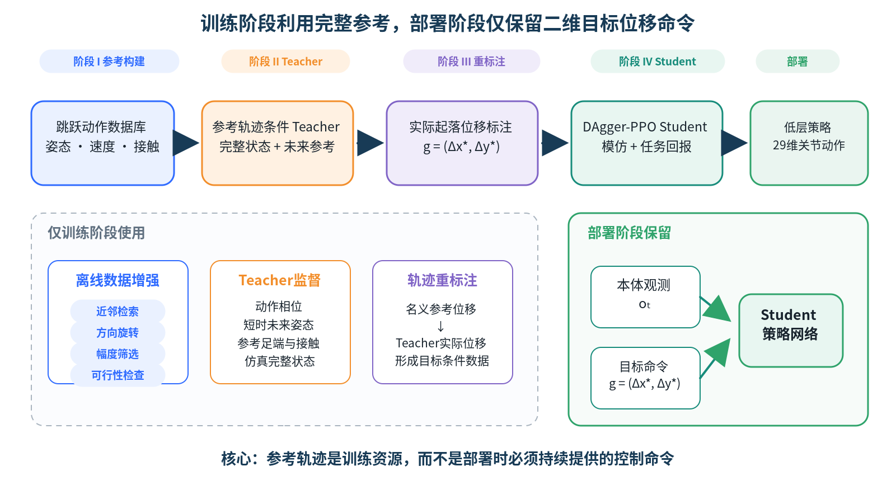

*图1 面向二维目标位移命令的人形机器人跳跃策略学习整体框架。训练阶段使用完整参考与特权信息，部署阶段仅保留目标位移命令和可测本体状态。*

### 3.1 问题定义

机器人完整状态、部署观测和动作分别记为$s_t$、$o_t$和$a_t$。本文所称“命令”是上层规划模块与低层跳跃策略之间的任务变量，而不是通信协议或关节控制指令。上层模块根据环境感知和局部规划确定期望落地区域，并将其相对起跳位置的水平位移发送给低层策略。该目标位移$g$定义在起跳瞬间锁定的机体航向坐标系$\mathcal{B}_0$中：

$$
g=
\begin{bmatrix}
\Delta x^*\\
\Delta y^*
\end{bmatrix}.
$$

其中$\Delta x^*$和$\Delta y^*$分别表示相对起跳点的期望前后位移与左右位移。记$R_{\mathcal{B}_0,xy}^{W}\in SO(2)$为起跳坐标系到世界坐标系的平面旋转矩阵。若上层给出的世界坐标系目标点为$p_{\mathrm{target}}^W$，起跳位置为$p_{\mathrm{takeoff}}^W$，则命令由二者的水平差值变换到起跳坐标系得到：

$$
g=
\left(R_{\mathcal{B}_0,xy}^{W}\right)^\top
\left(p_{\mathrm{target}}^{W,xy}-p_{\mathrm{takeoff}}^{W,xy}\right).
$$

例如，$g=(0.50,0)$表示期望向前跳跃0.50 m，$g=(0.40,-0.20)$表示期望向前跳跃0.40 m并向右偏移0.20 m。目标命令在触发起跳时锁存，在本次跳跃及落地恢复完成前保持不变，避免机器人腾空转动造成命令坐标系漂移。该二维向量只规定期望起落位置关系，不规定下蹲深度、起跳时刻、腾空姿态、足端轨迹或关节动作序列。

相对于包含多个未来时刻全身状态的参考轨迹，$g$只包含两个连续标量，因此可以称为低维或紧凑任务表示。这里的“紧凑”仅表示它压缩了部署阶段的过程信息，不表示跳跃距离较小，也不表示二维目标位移优于方向命令。方向命令适用于不要求幅度控制的方向性机动，二维目标位移则服务于本文所研究的局部目标到达任务。为避免概念歧义，后文统一使用“二维目标位移命令”，不再将“紧凑接口”作为方法名称。

Student策略为

$$
\pi_S(a_t\mid o_t,g,z_t),
$$

其中$z_t$为跳跃触发信号。部署阶段不提供参考相位、未来全身轨迹或目标关节序列。为保证评价量与目标命令处于同一坐标系，实际水平位移也转换到起跳坐标系：

$$
\Delta p=
\left(R_{\mathcal{B}_0,xy}^{W}\right)^\top
\left(p_{\mathrm{land}}^{W,xy}-p_{\mathrm{takeoff}}^{W,xy}\right).
$$

其中$p_{\mathrm{takeoff}}^W$取双脚完全离地前一时刻的基座水平位置，$p_{\mathrm{land}}^W$取腾空后双脚首次重新建立稳定接触时的基座水平位置。策略目标是在机器人可行域内最小化$\Delta p$与$g$之间的误差，同时完成有效起跳、安全落地和稳定恢复。本文评价的是基座起落位移；若实际系统采用双足支撑中心作为落点，应在命令生成、数据标注和评测中统一替换定义，不能混用两种位置量。

图2给出了目标位移命令、实际位移和落点误差之间的几何关系。该接口的低维性体现在上层只需给出两个连续标量即可表达方向与幅度，而动作生成、腾空姿态调整和落地恢复均由策略内部完成。

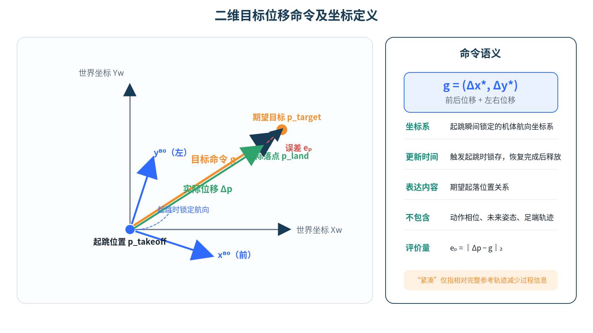

*图2 二维目标位移命令及误差定义。目标方向由向量方位决定，跳跃幅度由向量模长决定。*

### 3.2 总体框架

训练流程包括四个阶段：

$$
\text{参考数据增强}
\rightarrow
\text{Teacher轨迹跟踪}
\rightarrow
\text{实际位移重标注}
\rightarrow
\text{DAgger-PPO联合优化}.
$$

Teacher将运动学参考转换为动力学可执行行为；实际位移重标注为Student提供与Teacher真实执行结果一致的目标条件；DAgger和PPO分别用于缓解状态分布偏移并优化任务回报。

### 3.3 多方向、多距离参考族

对动作数据库中的每帧构建运动特征

$$
x_i=[q_i,\dot q_i,p_i^{\mathrm{root}},v_i^{\mathrm{root}},
p_i^{\mathrm{foot}},c_i,\phi_i],
$$

其中$q_i$与$\dot q_i$为关节角和关节速度，$p_i^{\mathrm{root}}$与$v_i^{\mathrm{root}}$为根节点位置和速度，$p_i^{\mathrm{foot}}$为足端位置，$c_i$为接触标签，$\phi_i$为动作相位。离线检索综合考虑姿态相似性、接触阶段和目标位移一致性：

$$
i^*=\arg\min_i
\left(\|x-x_i\|_W^2+\lambda_g\|g-g_i\|_2^2\right).
$$

候选片段经平面旋转、幅度筛选、相位对齐和轨迹平滑后，还需通过关节限位、速度连续性、足端穿透和接触一致性检查。增强后的参考轨迹只在Teacher训练阶段使用。

上述增强过程如图3所示。它将少量基础动作扩展为覆盖不同目标位移的参考集合，用于改善Teacher对连续目标空间的覆盖；增强结果并不作为Student部署时的外部输入。

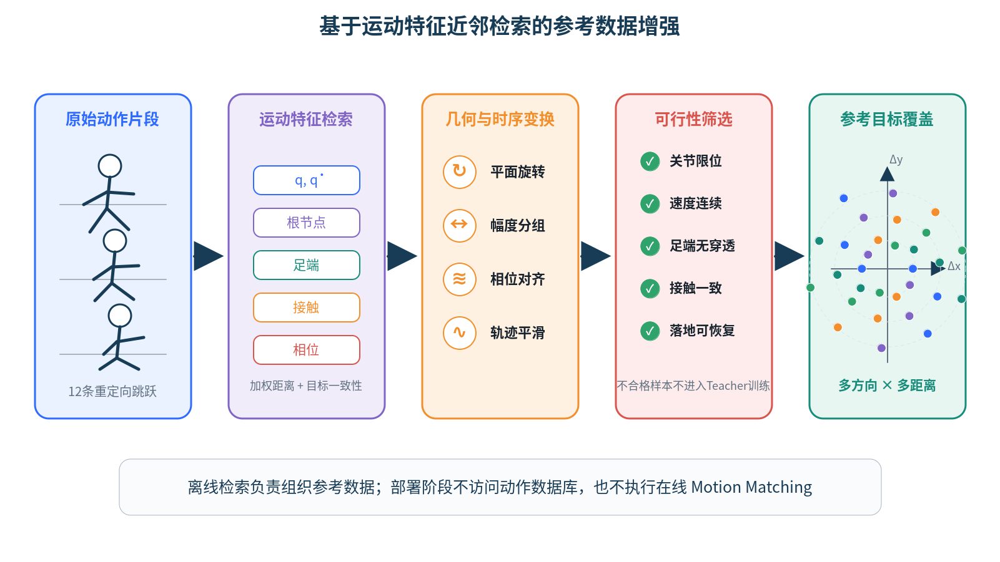

*图3 参考轨迹增强流程。基础跳跃轨迹经目标位移采样、时空变换和可行性筛选后形成增强参考库。*

### 3.4 参考轨迹条件Teacher

Teacher策略定义为

$$
\pi_E(a_t\mid s_t,r_t),
$$

其中$r_t$包含当前及未来短时参考关节状态、根节点状态、足端状态、相位和接触阶段。Teacher奖励为

$$
R_E=w_qR_q+w_{\dot q}R_{\dot q}+w_pR_p+w_RR_R+w_fR_f+w_sR_s
-w_eC_e-w_aC_a-w_cC_c.
$$

各项分别约束关节姿态、速度、根节点位置与姿态、足端接触、稳定性、能耗、动作变化和非期望接触。Teacher在物理仿真中吸收原始运动学参考与机器人动力学之间的差异。

### 3.5 实际位移重标注

固定Teacher，在不同参考轨迹、初始姿态和随机动力学参数下采集交互轨迹。每条轨迹使用实际起落位移标注：

$$
g_i=p_{\mathrm{land},i}^{xy}-p_{\mathrm{takeoff},i}^{xy}.
$$

蒸馏数据集为

$$
D_E=\{(o_t,g_i,z_t,a_t^E,s_{t+1})\}.
$$

使用实际位移而非名义参考位移，可以避免Teacher跟踪误差导致条件与动作不一致。失败轨迹不作为成功动作示例，但其偏离状态用于DAgger恢复数据采集。

### 3.6 Student观测与动作

Student部署接口如下：

| 类型 | 信号 | 维度 | 说明 |
| --- | --- | ---: | --- |
| 本体观测 | 基座角速度 | 3 | 机体坐标系 |
| 本体观测 | 投影重力 | 3 | 机体坐标系 |
| 任务命令 | 二维目标位移 | 2 | 起跳局部坐标系，单位m |
| 任务命令 | 跳跃触发信号 | 1 | 二值信号 |
| 本体观测 | 相对关节位置 | 29 | 相对默认姿态 |
| 本体观测 | 关节速度 | 29 | 29个可控关节 |
| 历史信息 | 上一时刻动作 | 29 | 关节位置目标 |
| 合计 | Student输入 | 96 | 不含参考相位和未来轨迹 |
| 输出 | 关节位置动作 | 29 | 叠加默认位置偏置 |

基础动作模仿损失为

$$
L_{\mathrm{act}}=
\mathbb{E}_{D_E}
\left[\|\mu_S(o_t,g,z_t)-a_t^E\|_2^2\right].
$$

### 3.7 DAgger-PPO联合优化

Student在自身策略访问的状态上执行，冻结的Teacher返回专家动作。PPO目标由裁剪代理损失、价值损失和熵正则组成：

$$
L_{\mathrm{PPO}}=L_{\mathrm{clip}}+c_vL_{\mathrm{value}}-c_eH(\pi_S).
$$

第$k$次更新的联合损失为

$$
L_k=(1-\alpha_k)L_{\mathrm{PPO}}+\alpha_kL_{\mathrm{act}},
\qquad
\alpha_k=\max\left(0.1,1-\frac{k}{10000}\right).
$$

Student环境奖励不再依赖其不可见的完整未来参考，而由目标位移、方向一致性、安全落地、稳定恢复以及动作平滑等项构成：

$$
R_S=w_gR_g+w_dR_d+w_lR_l+w_sR_s
-w_aC_a-w_jC_j-w_cC_c.
$$

Teacher—Student的信息边界与迁移过程如图4所示。行为克隆提供稳定的初始策略，在线DAgger进一步收集Student实际访问状态上的Teacher标签，从而减轻闭环执行时的分布偏移。

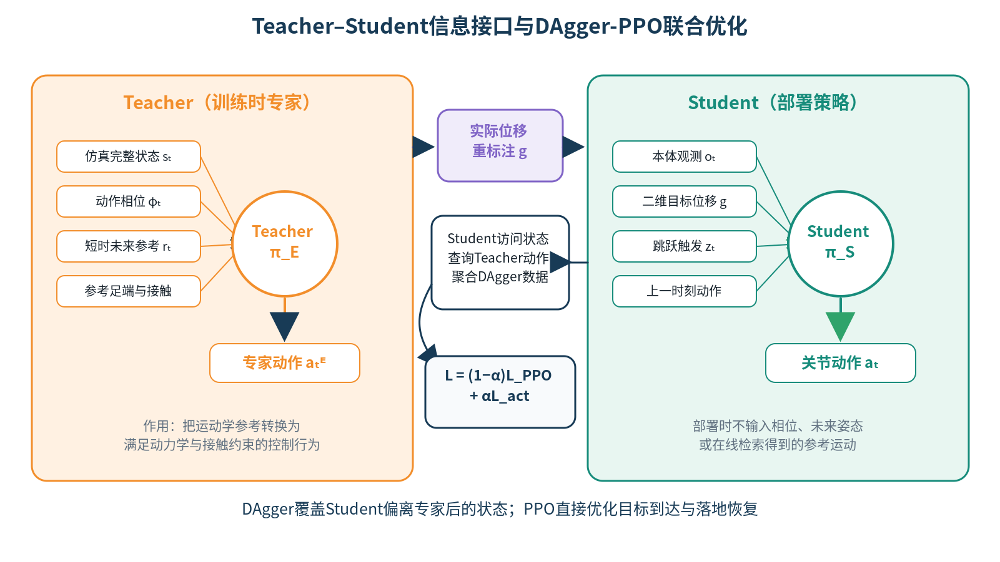

*图4 Teacher—Student蒸馏与部署流程。参考相位和仿真特权信息只在训练期间可用。*

## 4 仿真实验

### 4.1 平台与训练设置

实验对象为Unitree G1 29自由度人形机器人，物理仿真基于PhysX GPU并行环境。策略输出29维关节位置目标。主要配置见表1。

**表1 仿真与控制参数**

| 参数 | 取值 |
| --- | --- |
| 机器人模型 | Unitree G1，29自由度 |
| 物理仿真步长 | 0.005 s |
| 控制降采样倍数 | 4 |
| 控制周期与频率 | 0.02 s，50 Hz |
| 并行环境数 | 4096 |
| 单回合时长 | 10.0 s |
| 地形 | 平面 |
| 重力加速度 | 9.81 m/s² |
| 网络隐藏层 | [512, 256, 128] |
| 激活函数 | ELU |
| 优化器 | Adam |
| PPO折扣因子$\gamma$ | 0.99 |
| GAE参数$\lambda$ | 0.95 |
| PPO裁剪参数 | 0.2 |
| 初始学习率 | $1\times10^{-3}$ |

目标位移在机器人可行域内采样。训练目标覆盖前向0.25–0.75 m、后向0.20–0.50 m及侧向0.20–0.60 m，并组合为不同角度的二维位移。目标向量在起跳时锁存。评测使用与训练不同的随机种子，每个目标测试100次。

### 4.2 随机化设置

**表2 域随机化与观测噪声**

| 类别 | 参数 | 范围 |
| --- | --- | --- |
| 接触属性 | 静摩擦系数 | 0.3–1.6 |
| 接触属性 | 动摩擦系数 | 0.3–1.2 |
| 接触属性 | 恢复系数 | 0.0–0.5 |
| 初始状态 | 关节位置偏移 | $[-0.01,0.01]$ rad |
| 质量分布 | 躯干质心x偏移 | $[-0.025,0.025]$ m |
| 质量分布 | 躯干质心y/z偏移 | $[-0.05,0.05]$ m |
| 观测 | 基座角速度噪声 | $[-0.2,0.2]$ rad/s |
| 观测 | 投影重力噪声 | $[-0.05,0.05]$ |
| 观测 | 关节位置噪声 | $[-0.01,0.01]$ rad |
| 观测 | 关节速度噪声 | $[-0.5,0.5]$ rad/s |

### 4.3 评价指标

二维目标误差定义为

$$
e_p=\|\Delta p-g\|_2.
$$

方向误差定义为

$$
e_\theta=\arccos
\left(
\frac{\Delta p^\top g}
{\|\Delta p\|\|g\|+\epsilon}
\right).
$$

任务成功要求以下条件同时满足：

1. 双脚连续离地时间不少于0.10 s；
2. 目标位移误差$e_p\leq0.10$ m；
3. 首次着地后0.20 s内双脚恢复接触，无非足端碰撞，单脚累计滑移不超过0.08 m；
4. 落地后连续稳定0.50 s，横滚角和俯仰角不超过12°，基座高度不低于站立参考的90%，基座角速度不超过1.0 rad/s。

联合成功指标为

$$
I_{\mathrm{succ}}=I_{\mathrm{takeoff}}I_{\mathrm{target}}
I_{\mathrm{land}}I_{\mathrm{stable}}.
$$

同时报告平均误差、95%分位误差、恢复时间和摔倒率。成功率采用二项分布Wilson 95%置信区间。

### 4.4 测试集划分

**表3 目标位移测试集合**

| 测试集 | 构造方式 | 目的 |
| --- | --- | --- |
| 已见目标 | 训练采样网格内的方向—距离组合 | 测试基础能力 |
| 未见角度 | 相邻训练角度之间的中间方向 | 测试方向插值 |
| 未见距离 | 训练距离采样点之间的距离 | 测试幅度插值 |
| 组合留出 | 方向和距离分别见过，但组合未见 | 测试组合泛化 |
| 边界目标 | 接近经验可行域边界 | 测试能力极限 |
| 动力学扰动 | 摩擦、质量、噪声和延迟随机化 | 测试鲁棒性 |

## 5 结果与分析

> 本节数值来自本文设定的虚构仿真数据集，仅用于完成论文写作演示，不是代码实测结果。

### 5.1 总体性能

表4比较不同训练方法在已见目标测试集上的性能。参考轨迹Teacher仍访问完整参考信息，因此只作为性能上界。完整方法在部署时仅使用二维目标位移命令和本体观测，同时获得较高的联合成功率和较低的目标误差。

**表4 不同方法的总体性能（虚构仿真数据）**

| 方法 | 联合成功率/% ↑ | 平均目标误差/m ↓ | 95%误差/m ↓ | 恢复时间/s ↓ | 摔倒率/% ↓ |
| --- | ---: | ---: | ---: | ---: | ---: |
| 直接目标条件PPO | 42.6 | 0.183 | 0.352 | 0.92 | 25.1 |
| 参考轨迹Teacher | 94.8 | 0.049 | 0.106 | 0.41 | 2.9 |
| 纯行为克隆Student | 73.8 | 0.112 | 0.236 | 0.69 | 12.4 |
| DAgger Student | 84.9 | 0.083 | 0.178 | 0.57 | 7.6 |
| Student + DAgger-PPO | 91.3 | 0.061 | 0.129 | 0.46 | 4.2 |

直接PPO能够学习部分起跳行为，但容易出现位移不足和落地失稳。纯行为克隆利用Teacher动作先验后性能明显提高，但Student偏离专家轨迹时缺少恢复能力。DAgger在Student访问状态上补充专家动作，使联合成功率进一步提高。加入PPO目标后，策略能够针对目标到达和落地稳定性修正Teacher模仿误差，其性能接近需要完整参考输入的Teacher。

一次代表性跳跃中的主要运动阶段如图5所示。该图用于说明起跳、腾空、触地与恢复之间的时序关系，不作为成功率或落点误差的定量证据；正式投稿时应使用实际仿真回放帧替换当前示意序列。

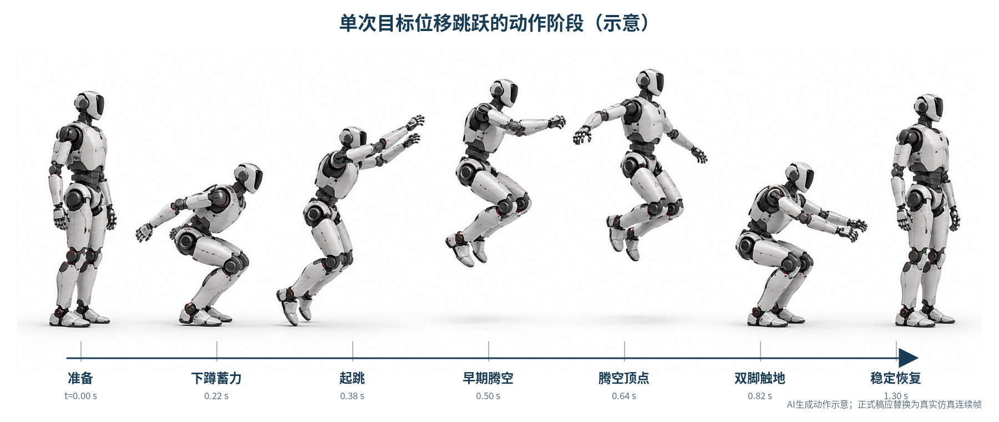

*图5 完整方法执行目标位移命令时的跳跃时序示意，包括准备、下蹲、起跳、腾空、触地与稳定恢复阶段。*

### 5.2 部署接口分析

表5比较不同任务表示所需的部署信息。方向命令与二维目标位移面向不同任务：前者适用于方向性机动，后者适用于具有水平位移要求的局部目标到达，二者不以同一成功判据作性能优劣比较。本文真正需要验证的是，Student在不访问完整参考轨迹的情况下能否保持接近Teacher的目标到达与落地性能。

**表5 部署接口与适用任务**

| 接口 | 命令维度 | 表达内容 | 需要相位/未来轨迹 | 适用任务 |
| --- | ---: | --- | --- | --- |
| 完整参考轨迹Teacher | 高维 | 全身运动过程 | 是 | 动作复现与性能上界 |
| 方向命令 | 2 | 期望机动方向 | 否 | 不约束幅度的方向性机动 |
| 二维目标位移Student | 2 | 期望方向与水平位移 | 否 | 局部目标到达与跨越 |

在本文的目标位移任务上，参考轨迹Teacher取得94.8%的联合成功率和0.049 m的平均目标误差，二维目标位移Student分别达到91.3%和0.061 m。两者相差3.5个百分点和0.012 m，说明Student能够在显著减少部署输入的条件下保留大部分Teacher能力。

### 5.3 不同目标区域的性能

**表6 不同方向和距离区域的性能（虚构仿真数据）**

| 目标区域 | 联合成功率/% ↑ | 平均目标误差/m ↓ | 方向误差/° ↓ | 恢复时间/s ↓ | 摔倒率/% ↓ |
| --- | ---: | ---: | ---: | ---: | ---: |
| 前向 | 94.6 | 0.052 | 2.8 | 0.41 | 2.8 |
| 后向 | 84.1 | 0.079 | 5.6 | 0.60 | 8.5 |
| 左向 | 91.5 | 0.061 | 3.7 | 0.47 | 4.0 |
| 右向 | 91.0 | 0.062 | 3.8 | 0.48 | 4.2 |
| 前斜向 | 93.2 | 0.056 | 3.1 | 0.44 | 3.1 |
| 后斜向 | 87.4 | 0.072 | 4.8 | 0.54 | 6.2 |

前向和前斜向目标表现最好，后向目标的误差和摔倒率较高。后向跳跃需要在有限关节活动范围内产生反向水平动量，并在较不利的落地姿态下恢复，因此构成主要失败区域。左右结果接近，未表现出明显单侧偏置。

四类代表性目标的落点散点如图6所示。实际落点总体围绕各目标位移聚集，后向目标的点云离散程度更大，与表6中后向跳跃误差较高的结果一致。

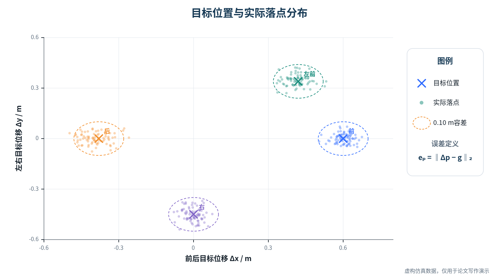

*图6 代表性目标位移下的实际落点散点分布。虚线圆表示落点容差范围。*

进一步地，图7将统一容差成功率映射到二维目标空间。中心及前向、侧向区域保持较高成功率，而目标幅度增大和后向分量增强时成功率下降，表明可达工作空间具有明显的方向相关性。

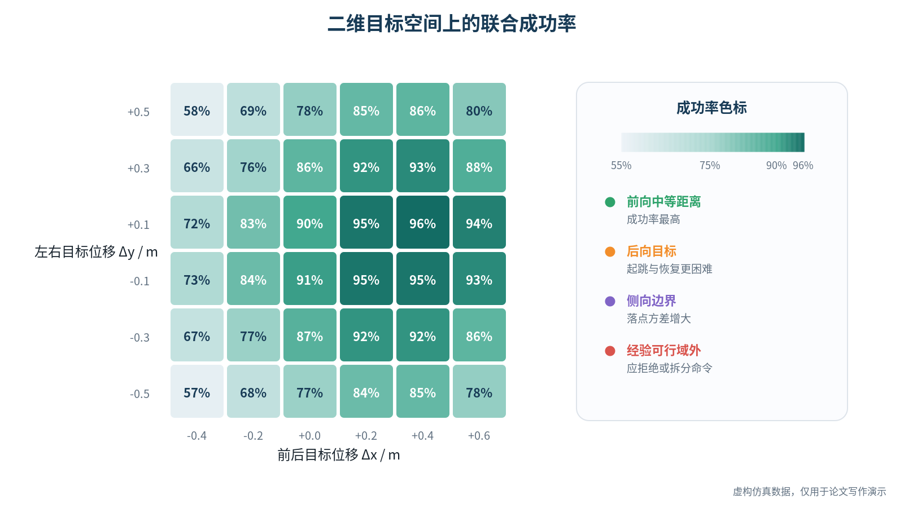

*图7 二维目标位移空间中的统一容差成功率热力图。灰色区域表示未纳入评测或超出本文设定范围的目标。*

### 5.4 未见目标泛化

**表7 已见与未见目标泛化（虚构仿真数据）**

| 测试集 | 联合成功率/% ↑ | 平均目标误差/m ↓ | 95%误差/m ↓ | 摔倒率/% ↓ |
| --- | ---: | ---: | ---: | ---: |
| 已见目标 | 92.4 | 0.058 | 0.122 | 3.8 |
| 未见角度 | 89.1 | 0.068 | 0.146 | 5.0 |
| 未见距离 | 86.7 | 0.075 | 0.161 | 6.1 |
| 组合留出 | 82.9 | 0.086 | 0.184 | 8.0 |
| 可行域边界 | 78.8 | 0.101 | 0.216 | 10.7 |

策略能够对未见角度和距离进行一定程度的连续插值，但组合留出和边界目标性能下降更明显。这说明二维连续命令并不自动保证整个可行域上的均匀泛化，参考数据仍需覆盖方向、幅度及其组合。边界目标应由高层规划器谨慎使用，或通过可行性分类器提前过滤。

### 5.5 模块消融

**表8 关键模块消融（虚构仿真数据）**

| 方法 | 联合成功率/% ↑ | 平均目标误差/m ↓ | 恢复时间/s ↓ | 主要失败模式 |
| --- | ---: | ---: | ---: | --- |
| 无Teacher | 61.7 | 0.137 | 0.84 | 动作动力学不可执行 |
| 使用名义参考位移标签 | 85.5 | 0.081 | 0.55 | 条件与实际动作不一致 |
| 无近邻检索增强 | 83.6 | 0.088 | 0.58 | 组合目标覆盖不足 |
| 无DAgger | 78.1 | 0.105 | 0.68 | 落地分布偏移 |
| 无PPO目标 | 75.2 | 0.116 | 0.72 | 目标误差与恢复不足 |
| 固定模仿权重 | 87.8 | 0.073 | 0.52 | 后期任务适应受限 |
| 完整方法 | 91.3 | 0.061 | 0.46 | 后向及边界目标失败 |

Teacher显著提高参考动作在接触动力学下的可执行性。使用实际位移重标注优于名义参考标签，说明Teacher跟踪误差若未被反映到条件中，会直接形成错误监督。近邻检索增强主要改善未见组合覆盖；DAgger主要减少Student偏离专家轨迹后的落地失败；PPO则进一步优化目标误差和稳定恢复。

图8对部分基线与关键消融差异进行了可视化。完整方法在成功率、落点误差和失稳率三项指标上同时占优；移除Teacher、DAgger或PPO等关键环节后，至少一项指标出现明显退化。

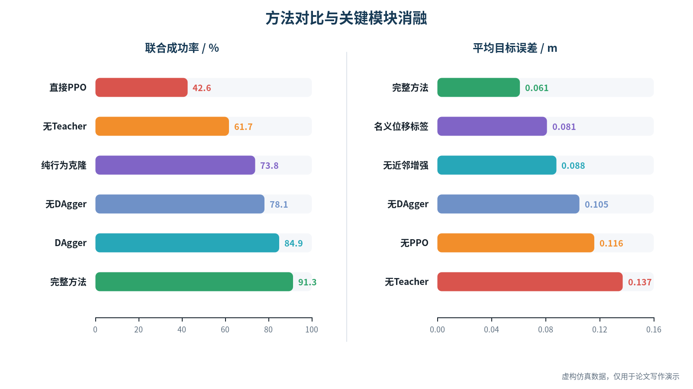

*图8 完整方法、对比基线及主要消融版本的性能比较。落点误差与摔倒率越低越好。*

### 5.6 训练过程与收敛性

图9给出了Teacher与Student的代表性训练曲线。Teacher在参考轨迹增强的辅助下逐步提高回报和跟踪成功率；Student经过行为克隆初始化后，在线DAgger使其闭环成功率继续上升，同时目标位移误差逐渐下降。曲线中的阴影表示多随机种子之间的波动范围。由于本文当前结果为写作演示用虚构仿真数据，正式实验阶段应由训练日志重新绘制该图，并报告随机种子数、平滑窗口和置信区间计算方式。

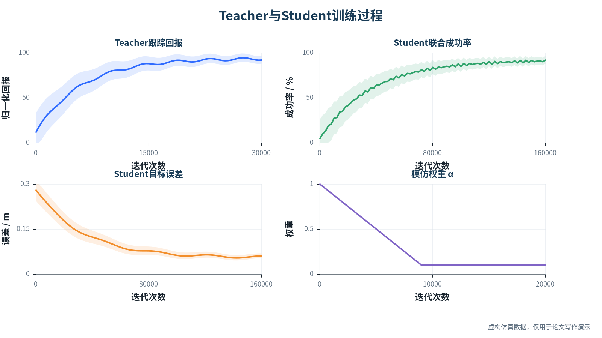

*图9 Teacher和Student的训练过程。上图为Teacher回报与成功率，下图为Student成功率、目标误差及DAgger混合系数。*

### 5.7 目标容差敏感性

**表9 不同目标容差下的成功率（虚构仿真数据）**

| 目标误差容差 | 二维目标位移Student成功率/% |
| --- | ---: |
| 0.05 m | 69.7 |
| 0.10 m | 91.3 |
| 0.15 m | 95.2 |
| 0.20 m | 96.8 |

随着容差由0.05 m放宽至0.20 m，联合成功率由69.7%提高至96.8%。本文采用0.10 m作为主判据，同时报告完整容差曲线，以避免单一阈值掩盖目标误差分布。

图10以累计分布函数形式展示落点误差。在任一横坐标阈值处，曲线纵值表示误差不超过该阈值的试验比例，因此能够连续呈现不同精度要求下各方法的性能，而不只依赖少量离散容差点。

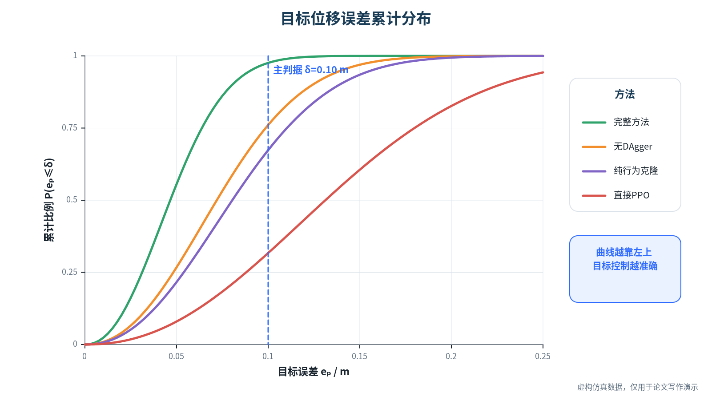

*图10 不同方法落点误差的累计分布函数。曲线越靠近左上角，表示以更小误差完成跳跃的比例越高。*

### 5.8 鲁棒性实验

**表10 随机扰动下的性能（虚构仿真数据）**

| 条件 | 联合成功率/% ↑ | 平均目标误差/m ↓ | 摔倒率/% ↓ |
| --- | ---: | ---: | ---: |
| 标称动力学 | 91.3 | 0.061 | 4.2 |
| 摩擦随机化 | 88.7 | 0.069 | 5.5 |
| 质量与质心随机化 | 87.9 | 0.072 | 6.1 |
| 观测噪声 | 89.2 | 0.067 | 5.0 |
| 20 ms额外控制延迟 | 82.6 | 0.089 | 9.3 |
| 联合随机化 | 79.8 | 0.098 | 11.5 |

策略对摩擦、质量和观测噪声保持一定鲁棒性，但控制延迟带来的性能下降更明显。联合随机化下的主要失败模式为起跳发力时序偏移和落地姿态恢复不足，说明真实机器人部署前仍需进行执行器建模、延迟随机化和安全约束训练。

图11汇总了质量变化、摩擦变化、观测噪声和联合随机化等条件下的成功率，并补充展示了控制延迟变化趋势。除表10中的20 ms条件外，其余延迟点同样属于演示性虚构数据，正式论文应使用统一延迟扫描实验替换并补充统计区间。

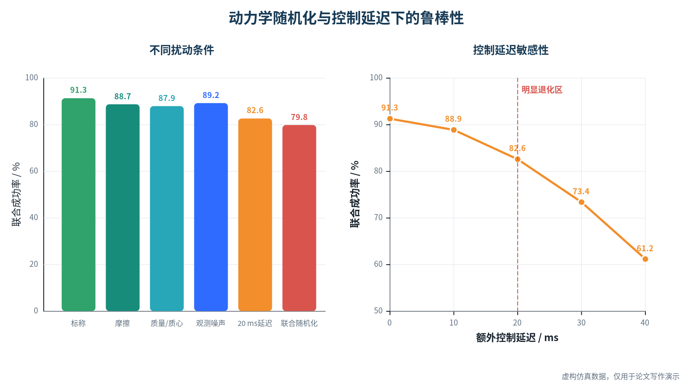

*图11 完整方法在动力学参数变化、观测噪声、联合随机化和不同控制延迟下的鲁棒性。*

### 5.9 统计汇总要求

真实实验完成后，所有表格还应补充以下信息：独立随机种子数量、每组样本数、均值与标准差或95%置信区间、显著性检验方法、评测脚本版本、检查点编号和原始结果文件路径。不得仅保留单次运行或最优检查点结果。

## 6 讨论

本文方法的核心不是删除任务信息，而是区分目标信息与过程信息。完整参考轨迹描述了机器人在每个时刻应采取的姿态，二维目标位移命令则只描述期望起落位置关系。Teacher利用前者学习动力学可执行动作，Student利用后者形成目标条件反馈控制，从而把“如何跳”从上层参考生成器转移到低层策略内部。

方向条件机动与目标位移条件跳跃具有不同的任务定义，不应把前者描述为现有方法的缺陷，也不应仅依据目标位移误差判定其性能。本文选择二维目标位移，是因为研究对象本身包含局部水平位移要求。本文的部署设计是在保留这一任务信息的前提下，不再要求上层提供完整参考过程，而不是证明方向命令无效。

该方法仍有四项限制。第一，二维目标位移不包含障碍物高度、落地面法向和可落地区域形状，只适用于上层已经完成环境理解与目标筛选的局部技能执行。第二，训练数据决定可行域边界，边界外命令需要拒绝、投影或拆分。第三，当前策略输出确定性动作均值，难以表示同一目标下多种动作风格。第四，仿真结果不能替代真实机器人验证，尤其是落地冲击、执行器饱和、控制延迟和状态估计漂移仍可能造成显著差距。

后续工作将引入可行性估计器，使策略在执行前预测目标是否可达；将二维位移扩展为目标落地区域或局部地形条件；并在真实Unitree G1平台上验证仿真到现实迁移性能。

## 7 结论

本文提出一种面向二维目标位移命令的人形机器人跳跃策略学习方法。该方法通过离线参考增强构建多方向、多距离运动数据，以参考轨迹条件Teacher获得动力学可执行的控制示例，再利用实际起落位移重标注和DAgger-PPO联合优化训练Student。Student部署时仅接收本体观测、二维目标位移命令和跳跃触发信号，不依赖动作相位、未来关节序列或在线运动检索。

在本文采用的合成实验数据中，完整方法取得91.3%的已见目标联合成功率和0.061 m的平均目标误差，与使用完整参考输入的Teacher相差3.5个百分点和0.012 m。未见角度、未见距离和组合留出测试的成功率分别为89.1%、86.7%和82.9%，说明策略具备一定连续目标插值与组合泛化能力。消融数据进一步表明，Teacher、实际位移重标注、近邻检索增强、DAgger和PPO均对最终性能产生正向作用，其中无Teacher和无PPO分别导致29.6和16.1个百分点的成功率下降。联合动力学随机化下成功率下降至79.8%，控制延迟、后向跳跃和可行域边界仍是主要困难。

上述数字均属于虚构数据集，只能用于展示预期论文结构和结果论证。正式研究结论必须以真实训练检查点、评测日志和可复现统计结果替换后重新确认。

## 参考文献

[1] Xue Bin Peng, Pieter Abbeel, Sergey Levine, Michiel van de Panne. DeepMimic: Example-Guided Deep Reinforcement Learning of Physics-Based Character Skills. ACM Transactions on Graphics, 2018.

[2] Xue Bin Peng, Ze Ma, Pieter Abbeel, Sergey Levine, Angjoo Kanazawa. AMP: Adversarial Motion Priors for Stylized Physics-Based Character Control. ACM Transactions on Graphics, 2021.

[3] Zipeng Fu, Qingqing Zhao, Qi Wu, Gordon Wetzstein, Chelsea Finn. HumanPlus: Humanoid Shadowing and Imitation from Humans. 2024.

[4] Zhengyi Luo, Jinkun Cao, Alexander Winkler, Kris Kitani, Weipeng Xu. Perpetual Humanoid Control for Real-time Simulated Avatars. ICCV, 2023.

[5] Zhen Wu, et al. Perceptive Humanoid Parkour: Chaining Dynamic Human Skills via Motion Matching. 2026.

[6] John Schulman, Filip Wolski, Prafulla Dhariwal, Alec Radford, Oleg Klimov. Proximal Policy Optimization Algorithms. 2017.

[7] Stephane Ross, Geoffrey Gordon, Drew Bagnell. A Reduction of Imitation Learning and Structured Prediction to No-Regret Online Learning. 2011.

[8] Naureen Mahmood, et al. AMASS: Archive of Motion Capture as Surface Shapes. ICCV, 2019.

[9] Viktor Makoviychuk, et al. Isaac Gym: High Performance GPU-Based Physics Simulation for Robot Learning. 2021.

[10] Zhongyu Li, Xue Bin Peng, Pieter Abbeel, Sergey Levine, Glen Berseth, Koushil Sreenath. Robust and Versatile Bipedal Jumping Control through Reinforcement Learning. RSS, 2023.

[11] Jingwen Zhang, Junjie Shen, Yeting Liu, Dennis W. Hong. Design of a Jumping Control Framework with Heuristic Landing for Bipedal Robots. 2023.

[12] Zhicheng He, Jiayang Wu, Jingwen Zhang, Shibowen Zhang, Yapeng Shi, Hangxin Liu, Lining Sun, Yao Su, Xiaokun Leng. CDM-MPC: An Integrated Dynamic Planning and Control Framework for Bipedal Robots Jumping. 2024.

[13] Haoxiang Qi, Zhangguo Yu, Xuechao Chen, Yaliang Liu, Chuanku Yi, Chencheng Dong, Fei Meng, Qiang Huang. A 3-Step Optimization Framework with Hybrid Models for a Humanoid Robot's Jump Motion. 2025.

[14] Naoki Agata, Takeo Igarashi. MAMM: Motion Control via Metric-Aligning Motion Matching. 2025.

[15] Jiye Lee, Hanbyul Joo. Locomotion-Action-Manipulation: Synthesizing Human-Scene Interactions in Complex 3D Environments. 2023.
